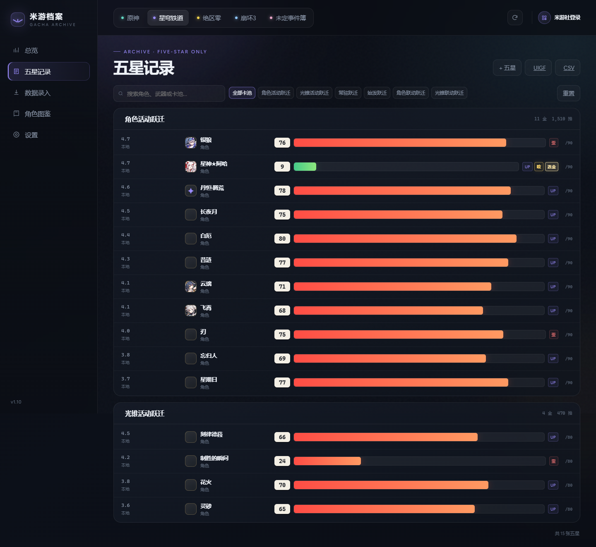
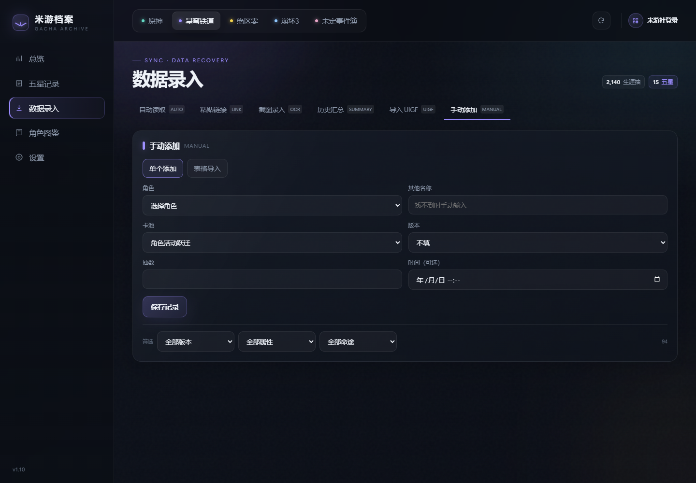

# 二游档案

本地优先的二游抽卡记录归档工具，支持原神、崩坏：星穹铁道、绝区零、崩坏3、未定事件簿，以及明日方舟、明日方舟：终末地、异环。

所有抽卡数据保存在自己电脑的软件目录里，不上传云端，不依赖账号，不写 AppData。无广告、无捆绑、无后台推广，纯绿色便携使用。

> **v2.00 起更新仓库迁移到 [`ichiryu0021/gacha-archive`](https://github.com/ichiryu0021/gacha-archive)。**
> 旧仓库 `miyou-archive` 只保留 2.00 及以前的备份，不再接收 2.00 之后的更新。






## 核心功能

- **本地保存，防止数据丢失**：记录、备份、米游社登录态全部保存在软件目录 `data/`。
- **自动归档**：读取本机游戏缓存和官方抽卡接口，自动合并五星记录。
- **五星档案**：只保留五星，按卡池分组，统计出金抽数、UP/歪、命中率、平均出金。
- **UP / 歪判定**：内置当前卡池表和角色图鉴，六星 / S 级记录按卡池 UP 名单自动判定 UP 或歪；卡池表暂更新到 2026-11-19。
- **可更新图鉴**：角色、武器/弧盘带图片；米哈游走官方 wiki，明日方舟/终末地/异环走游戏数据镜像，来源见 [docs/CATALOG_SOURCES.md](docs/CATALOG_SOURCES.md)。
- **版本统计**：按版本查看抽数、五星和生涯覆盖。
- **账号入口双页卡**：右上角账号入口分为「游戏账号」和「账号登录」；游戏账号列表负责查看、同步和退出，账号登录页负责米游社 / 森空岛 / 塔吉多登录。
- **多种录入方式**：米哈游游戏支持自动读取、粘贴链接、截图 OCR、UIGF；明日方舟/终末地/异环在「数据录入」里提供官方同步、截图 OCR、手动添加和 Excel，明日方舟支持导入小黑盒 JSON，终末地额外支持本机链接/粘贴链接，异环支持 NTEUID 和 NTE Gacha Exporter 完整导出。
- **小黑盒实验导入**：桌面版可打开隔离的小黑盒窗口，手动登录后采集页面 JSON；只读、仅内存会话，不保存密码或 Cookie，失败可回退 JSON。限制见 [docs/HEYBOX_LIVE.md](docs/HEYBOX_LIVE.md)。
- **异环内置抓取**：内置 NTE Gacha Exporter CLI，支持手动只读抓取和自动翻页两种模式；完整抽卡流水导入后计算真实总抽和 S 垫抽。见 [docs/NTE_CAPTURE.md](docs/NTE_CAPTURE.md)。
- **分享总结**：一键生成 JPG 抽卡总结，可复制到剪贴板或保存文件。
- **本地备份**：支持 UIGF、CSV 导出和整库备份；明日方舟可从小黑盒 JSON 导入历史寻访。
- **自动更新**：启动检查新版本，小版本走最小更新，更新不覆盖用户数据。

## 支持游戏

| 游戏 | 自动同步 | 手动/Excel | 分享 | 版本统计 |
|---|---|---|---|---|
| 原神 | ✓ | ✓ | ✓ | ✓ |
| 崩坏：星穹铁道 | ✓ | ✓ | ✓ | ✓ |
| 绝区零 | ✓ | ✓ | ✓ | ✓ |
| 明日方舟 | ✓ 森空岛扫码（约 90 天窗口） | ✓ | ✓ | 手动 |
| 明日方舟：终末地 | ✓ 本机链接 / 森空岛（约 90 天窗口） | ✓ | ✓ | 手动 |
| 异环 | ✓ 塔吉多登录（实验性）/ NTEUID 导入 | ✓ | ✓ | 手动 |
| 崩坏3 | — | ✓ | ✓ | 手动 |
| 未定事件簿 | — | ✓ | ✓ | 手动 |

崩坏3、未定没有公开抽卡接口，使用手动录入和 Excel 兜底。明日方舟、终末地、异环的官方接口说明和限制见 [docs/THIRD_PARTY_GACHA_APIS.md](docs/THIRD_PARTY_GACHA_APIS.md)，近期改动见 [docs/CHANGELOG.md](docs/CHANGELOG.md)。三款游戏只归档最高稀有度（六星 / S 级）。

## 数据与隐私

- 数据目录：软件目录下的 `data/`
- 不写入 `%APPDATA%`
- 抽卡 authkey 只保存在内存，不落盘
- 米游社登录态使用 Windows DPAPI 加密
- 不收集使用数据，不上传抽卡记录

## 启动

- 便携版：运行 `二游档案/二游档案.exe`
- 源码运行：安装 Node.js 22.5+ 后执行 `npm install`，再运行 `npm start`

## 开发

```powershell
npm install
npm start
npm test
```

## 开源与致谢

- 代码：MIT License
- Electron：MIT
- QR Code Generator for JavaScript：MIT
- genshin-db：MIT
- SheetJS xlsx：Apache-2.0
- 星穹铁道 / 绝区零图鉴：HoYoWiki 官方数据
- 游戏素材版权归 miHoYo / HoYoverse 所有；本项目为非官方工具

详细许可见 [THIRD_PARTY_NOTICES.md](THIRD_PARTY_NOTICES.md)。
