# 二游档案 · 「机能」主题

一套可独立运行、也可内置进打包开发版的机甲 / 机能风界面主题：工业仪表、全直角几何、钢灰纸墨与柠檬黄信号色。

> 主题归类索引见 [../README.md](../README.md)，接口标准见 [../THEME-INTERFACE.md](../THEME-INTERFACE.md)，主题清单见 [`theme.json`](theme.json)。

- **三个主题**：「机能 · 黑」（默认，黄字） / 「机能 · 白」（纸白，灰字阴影） / 「经典」（原版）。
- **开发版内置**：`npm.cmd run pack` 会把动态主题加载器和完整 `themes/` 放进 `dist\二游档案`，打开即「机能 · 黑」；主题卡和按游戏映射随 Electron 用户数据保存。
- **独立入口**：`node themes/mecha/server.mjs` 可用于浏览器预览和主题开发，状态由独立主题接口保存。
- **主题自动发现**：`themes/<id>/theme.json` + `theme.css` 放入 `themes/`，刷新设置页即可识别；也可以按游戏指定主题。
- **主题接入**：页面不写死主题列表；`src/server.js` 只增加只读主题目录/文件路由，`theme-loader.js` 负责动态 JSON、CSS、设置卡和持久化。
- **动效**：Hero 瞄准环旋转 + 呼吸；命中率环缩放 + 弧线加载；卡池/垫抽/月度/时间轴条缩放；关键数字从 0 计数到终值；均支持 `prefers-reduced-motion`。
- **分享图跟随主题**：黑色机能用石墨 + 黄信号 + 工程网格；白色用纸白 + 灰字 + 暗黄；经典保留原版深色玻璃分享图。
- **小装饰跟机体色**：卡片标尺、页面编号、导航激活条、四角括号、Tabs、步骤编号等小块装饰使用当前游戏主题色；黄仍是系统信号色。
- 删掉 `themes/mecha/` 后重新构建，开发版回到原版界面。

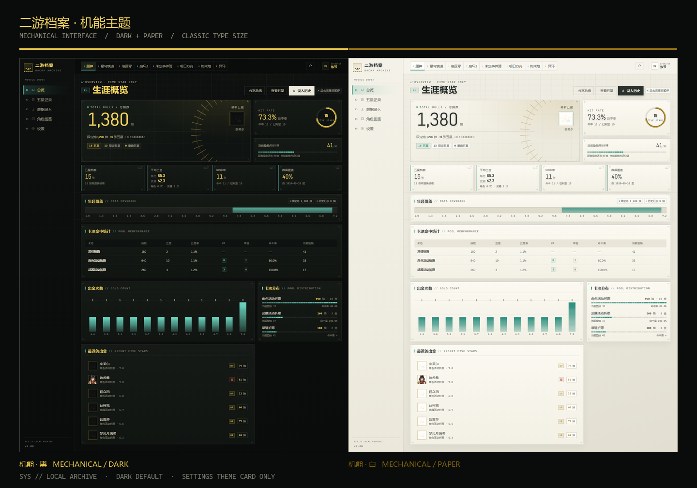

## 快速开始

要求 Node.js 22.5+（与原项目一致）。

### 方式 A：开发版内置（日常使用）

```powershell
cd D:\Project\二游档案
npm.cmd run pack
```

然后运行：

```
D:\Project\二游档案\dist\二游档案\二游档案.exe
```

打开即「机能 · 黑」。在「设置 → 界面主题」卡片切「机能 · 白」/「经典」，下次启动沿用。

### 方式 B：独立主题入口（浏览器预览 / 主题开发）

```powershell
# 在项目根目录启动主题入口
node themes/mecha/server.mjs

# 或使用演示数据
node themes/mecha/server.mjs --demo
```

也可以直接双击 `themes/mecha/start.cmd`（需要时可追加 `--demo`）。

然后打开：

```
http://127.0.0.1:8791
```

## 运行方式

### 方式一：主题入口自带数据服务（默认）

入口会以随机内部端口启动原版 `src/server.js`，再在 `8791` 上代理页面并注入主题。

- 默认数据目录：项目根目录 `data/`（同原版）。
- 使用 `--demo` 时读取 `demo-data/`，不碰正式数据。
- 主题状态保存在 `themes/mecha/.theme-state.json`（已在本地 `.gitignore` 中）。

### 方式二：复用已经启动的原版服务

如果已经用 `npm start` 或 Electron 打开了原版，可以避免重复启动数据服务：

```powershell
node themes/mecha/server.mjs --backend http://127.0.0.1:8787
```

此时入口只做代理与主题注入，不再启动第二个数据服务。

> 同一时间只建议有一个写 `data/app.json` 的实例。用 `--backend` 复用已有实例最稳。

### 端口

```powershell
$env:THEME_PORT=8792; node themes/mecha/server.mjs
```

或：

```cmd
set THEME_PORT=8792 && node themes/mecha\server.mjs
```

主题选择与端口无关，换端口不会丢设置（状态保存在主题包内）。

## 切换与保存

| 模式 | 切换入口 | 保存方式 |
| --- | --- | --- |
| 开发版内置 | 设置页「界面主题」卡片 | `ga_theme` Cookie，随 Electron `data/electron/` 保留 |
| 独立主题入口 | 同上 | `themes/mecha/.theme-state.json` + `/__theme/api/*` |

- 默认：`mecha`（机能 · 黑）。
- 可选：`light`（机能 · 白，纸白/灰字阴影）、`classic`（原版）。
- 开发版内置：Cookie 按 `127.0.0.1` 记录，**与随机端口无关**，下次启动沿用；首屏 HTML 先读取 Cookie，再加载主题 CSS，避免先闪错误主题。
- 独立入口：服务端返回 HTML 时已带上 `data-theme` + `data-mecha-variant`；状态通过 `GET /__theme/api/state`、`POST /__theme/api/theme` 读写。
- 面板里会显示「已保存 · 下次启动沿用」。

## 两种零改动接入方式

### 1. 打包开发版内置（构建期注入）

`scripts/pack.cjs` 在打包完成后、替换 `dist\二游档案` 之前：

1. 把 `themes/mecha/theme.css` 复制为 `resources/app/public/theme-base.css`；
2. 把 `themes/runtime/theme-loader.js` 复制为 `resources/app/public/theme-loader.js`；
3. 向打包后的 `public/index.html` 注入首屏 Cookie 引导、基础样式和加载器；
4. 把完整 `themes/` 复制到程序根目录（排除 `.theme-state.json`）。

页面不再写死主题 CSS 链接；加载器通过 `/__theme/themes.json` 读取目录，并按当前游戏加载主题。

### 2. 独立主题入口（运行时注入）

主题入口是一个独立的小型代理，做三件事：

1. **启动或复用原服务**：页面、接口、图片、二维码、导出全部原样代理。
2. **注入资源**：只向返回的 HTML 注入
   - `<html data-theme="...">`
   - `<link rel="stylesheet" href="/__theme/base.css">`
   - `<script src="/__theme/theme.js"></script>`
3. **动态目录**：入口扫描 `themes/`，提供 `/__theme/themes.json`、`/__theme/files/*` 和状态 API。
4. **注入少量 UI**：只注入设置页主题卡片和按游戏选择；原应用重渲染页面后，加载器会自动补回。

两种方式共用同一套 `theme.css` / `theme.js`；所有视觉规则都限定在 `html[data-theme="mecha"]` 作用域内。切回「经典」时，原版页面视觉保持原样，仅额外保留设置页主题卡片。

主题入口的代码：

```
themes/mecha/
├─ server.mjs          # 独立入口：内部服务 / 复用服务 + 代理注入 + 主题状态 API
├─ start.cmd           # Windows 双击启动
├─ public/
│  ├─ theme.css        # 机能主题样式（全部作用域限定）
│  └─ theme.js         # 主题切换 UI、设置页卡片、状态保存
├─ screenshots/        # 视觉记录
├─ DESIGN.md           # 设计语言与组件规范
└─ README.md
```

## 设计摘要

- **概念**：机库维修终端 / 工业仪表 / 编辑排版。数据像仪表读数一样被摆放。
- **三条规则**
  1. 纸墨是主体，黄色只用于需要被看见的那一处；小块装饰优先跟随当前游戏机体色。
  2. 全直角；只有命中率圆环这类必须为圆形的图形保留圆形。
  3. 数字等宽，技术标签等宽大写，标题宽字距。
- **机能 · 黑**：石墨黑 `#0b0d0c` + 黄色主字 `#f2d35f`；骨白只用于按钮/读数块等实底；每个游戏保留自己的「机体涂装色」用于数据、图表和小装饰。
- **机能 · 白**：纸白 `#f2efe6` / `#faf8f1`，主字深灰 `#2b312d` 带纸面压印阴影；亮黄只作实底，文字用琥珀墨，图表和小装饰用白底可读的机体色。
- **几何**：1px 发丝线、卡片四角括号、顶部警示条纹、24 / 120px 蓝图网格、分段式圆环与垫抽条。
- **字体**：Bahnschrift（数字 / 展示）、Segoe UI Variable + 微软雅黑（中文）、Cascadia Mono（技术标签）。
- **字号**：与经典主题完全一致；主题只改字体、字重、字距、颜色，不再放大或缩小正文和数字。
- **动效**：瞄准环 30s 旋转 + 4.8s 呼吸；圆盘/条状入场缩放；命中率弧线从 0 扫到目标；数字 0→终值；reduced-motion 下直接落终态。
- **标志性细节**：导航编号 `01–05`、页面索引、`//` 标签、Hero 瞄准弧、奶油色主按钮、骨白抽取数块、`POOL //` 记录分组、`SYS // LOCAL ARCHIVE`。

完整色板、字号、组件尺寸、交互规则见 [DESIGN.md](DESIGN.md)；主题清单字段和接入契约见 [../THEME-INTERFACE.md](../THEME-INTERFACE.md)。

### 截图

| 页面 | 截图 |
| --- | --- |
| 机能 · 黑 总览 | 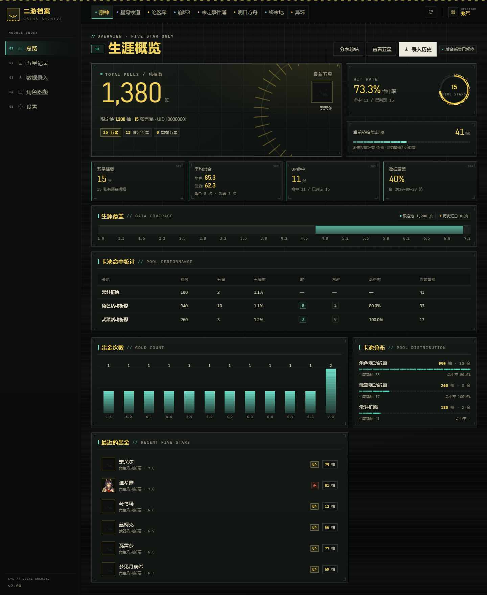 |
| 机能 · 白 总览 | 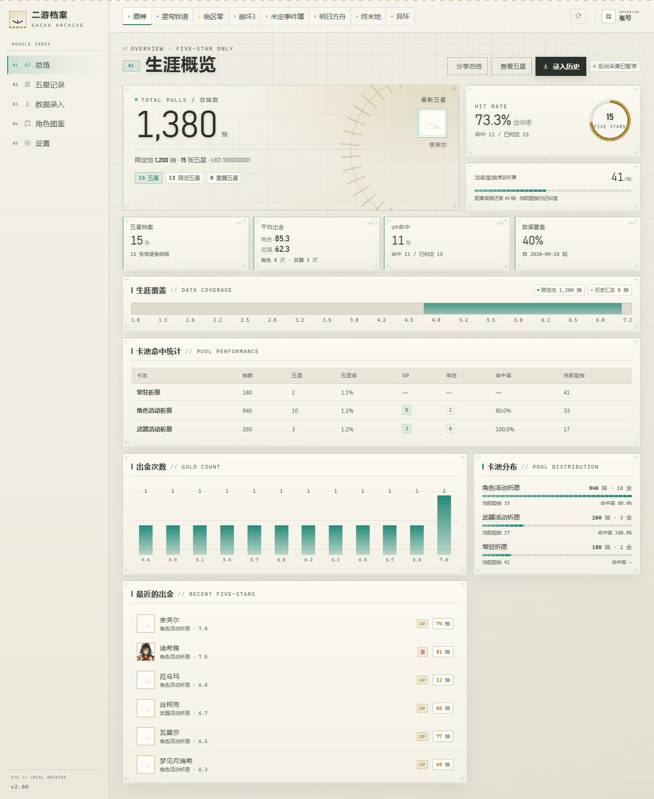 |
| 设置（黑，主题卡） | 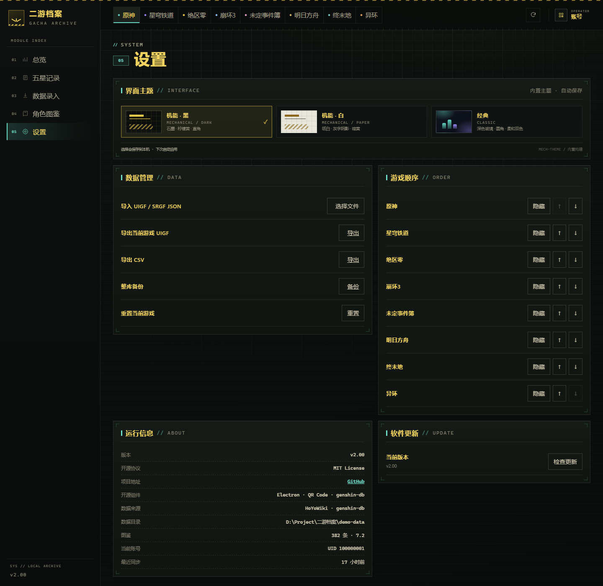 |
| 设置（白） | 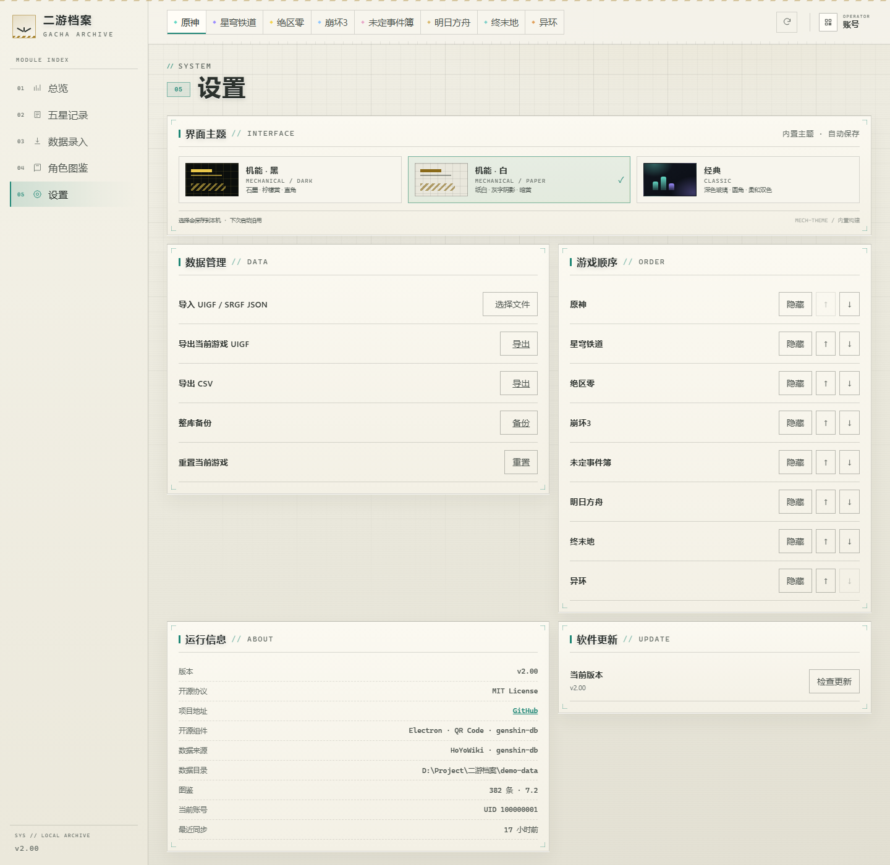 |
| 记录（白） | 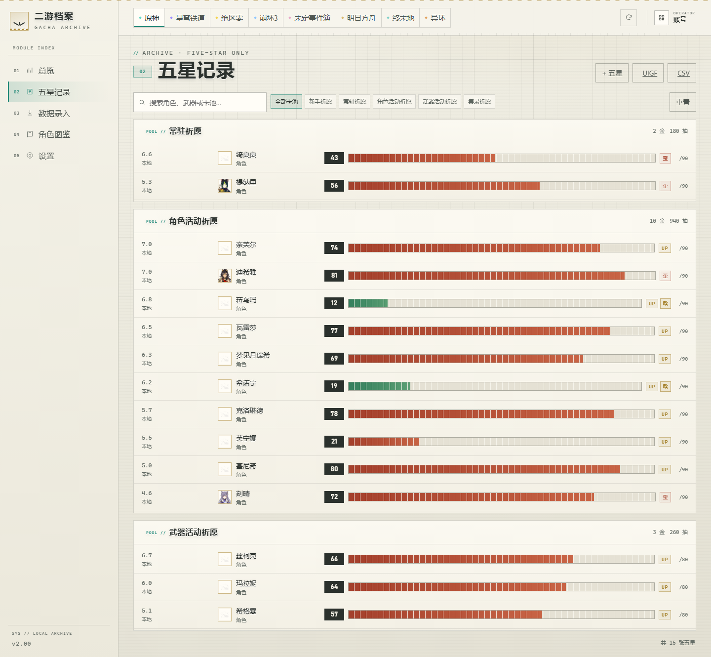 |
| 数据录入（白） | 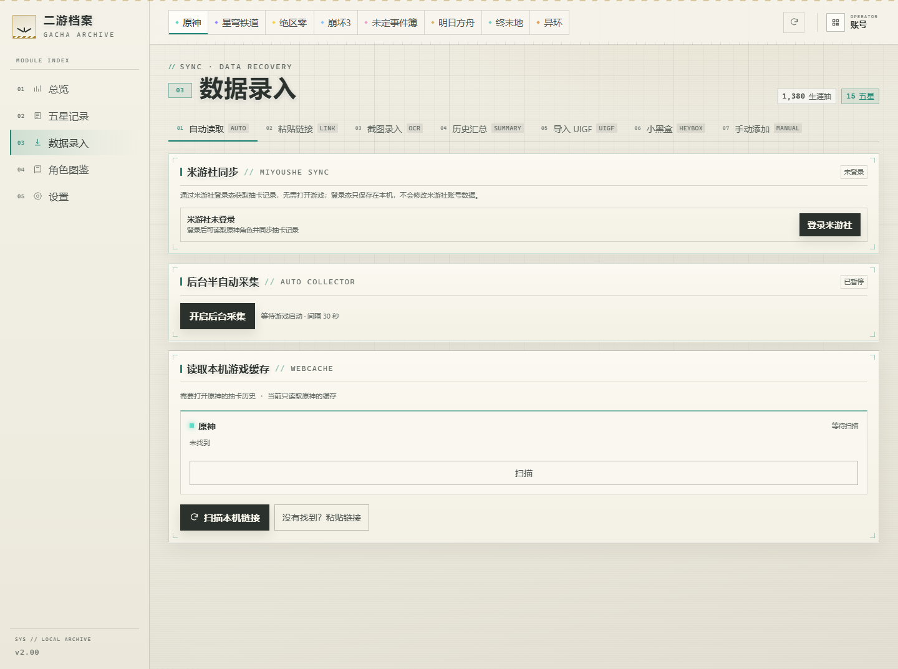 |
| 图鉴 | 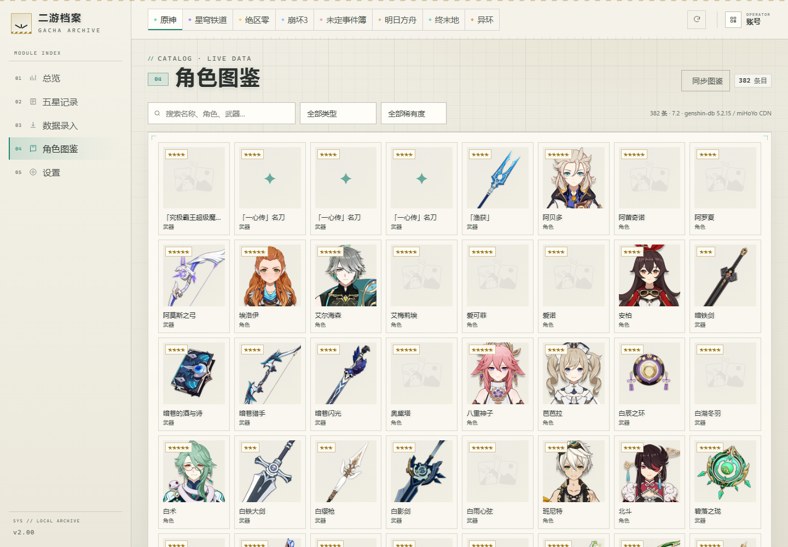 |
| 移动端（黑） | 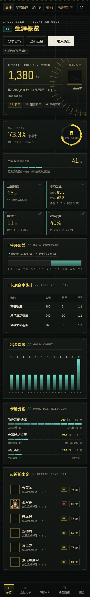 |
| 移动端（白） | 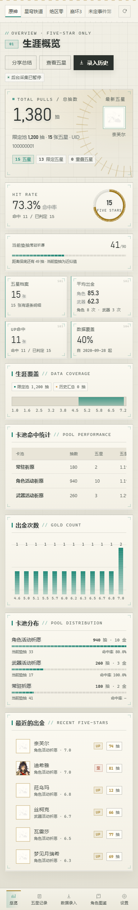 |
| 入场动画（黑） | 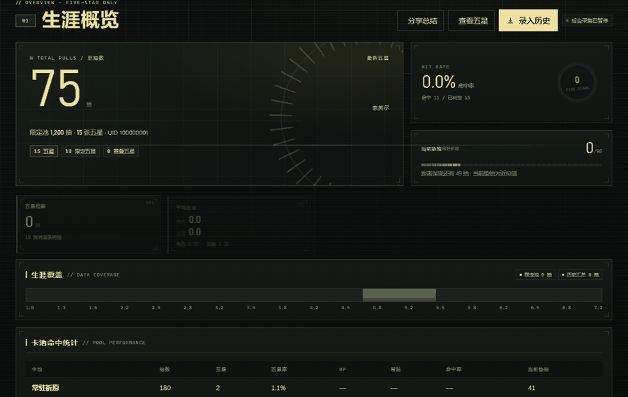 |
| 入场动画（白） | 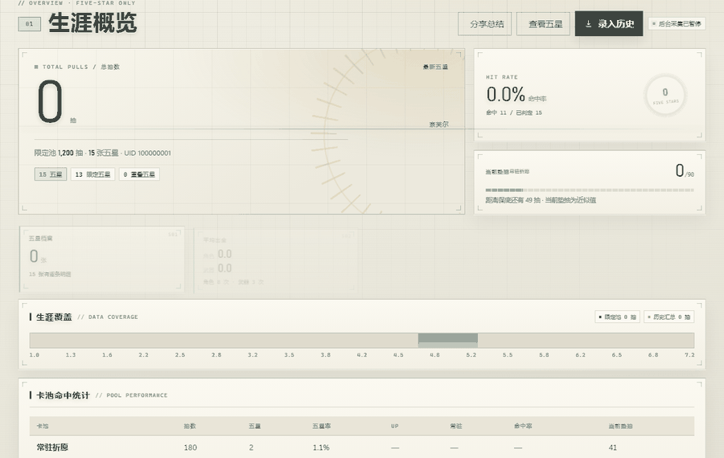 |
| 分享图（黑） | 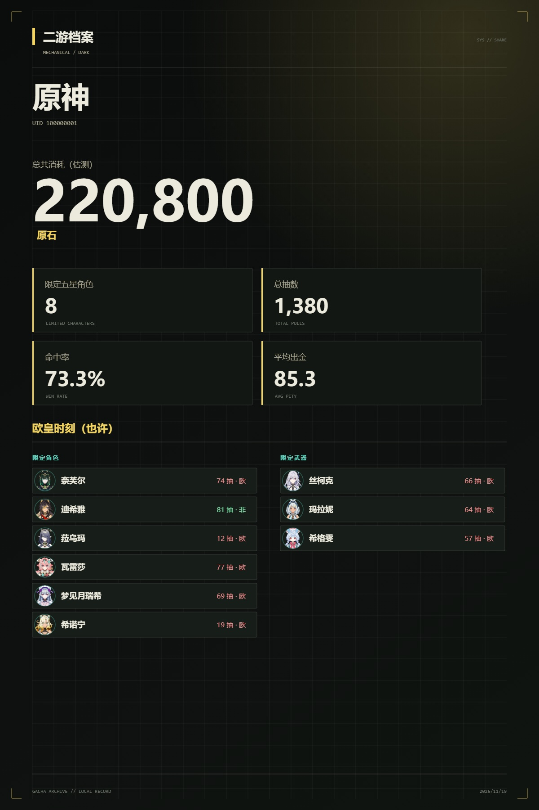 |
| 分享图（白） | 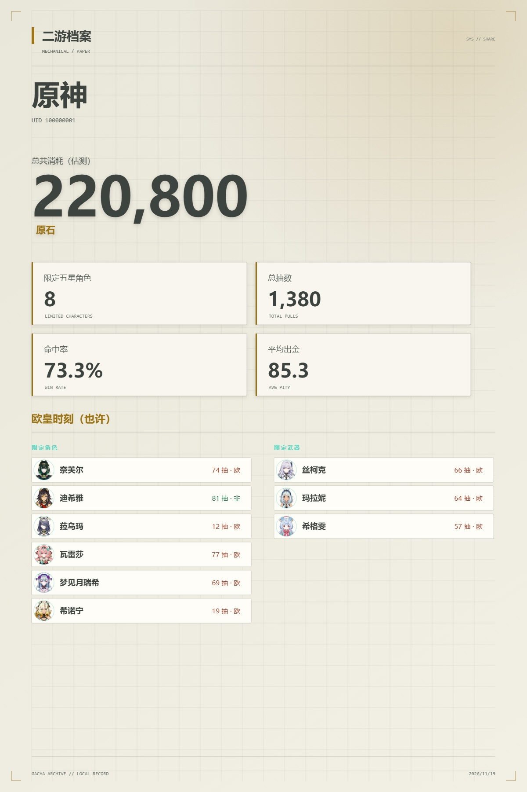 |
| 经典（原版） | 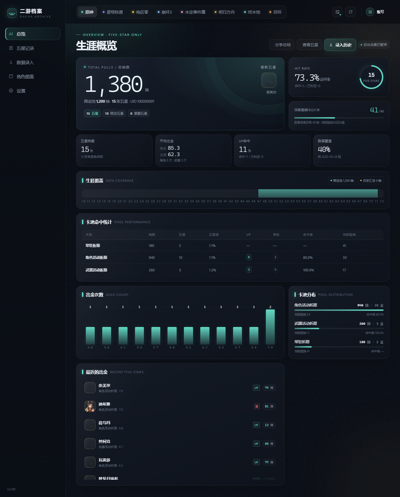 |

## 验证

- **动态主题目录**：独立入口 3 主题、按游戏映射、刷新保留：**11/11 通过**。
- **打包版动态加载**：默认黑、全局/按游戏映射、Cookie 持久化、重载恢复：**12/12 通过**。
- **Drop-in 新主题**：只放 `themes/<id>/theme.json + theme.css`，刷新即出现在主题卡和游戏映射中：**8/8 通过**。
- **字号**：黑、白两版与经典逐项对比，顶栏无主题选择器。
- **分享图**：黑 / 白 / 经典三套生成成功，无运行期异常：**8/8 通过**。
- 原项目测试：`node --test tests/core.test.mjs` **31/31 通过**。
- 视觉检查宽度：1440 / 1280 / 1024 / 390。
- 主题入口测试：自带数据服务、`--backend` 复用、`--demo` 演示数据均可用。

## 已知边界

- **分享总结 JPG** 由原应用 canvas 绘制，但会读取 `window.__gachaThemeShare()`；黑 / 白使用主题配色、直角和网格，经典保留原版深色玻璃风格。主题包不拦截分享数据逻辑。
- **源码开发运行**（`npm start` / `npm run desktop`）仍是原版界面；只有通过 `npm.cmd run pack` 生成的开发版会内置主题。想在不打包时预览主题，请用独立主题入口。
- `dist\` 里已有的 v2.00 zip 是**集成主题前**的产物；要让发布包带机能界面，需要从当前 `dist\二游档案` 重新生成 zip。
- 删除 `themes/mecha/` 后重新构建，开发版会回到原版界面；已经构建出的 `dist\二游档案` 会保留一份主题副本，直到下一次构建。
- 字体依赖 Windows 自带的 Bahnschrift / Cascadia Mono，其他平台会回退到 Segoe UI / Consolas。
- 主题卡使用少量现代 CSS（`:has`、`mask`），目标环境为 Chromium / Edge / Electron；更老的浏览器会缺少页面索引或遮罩细节，但功能不受影响。
- 主题状态文件位于主题包目录，需要可写；主题选择不写入 `data/`，也不修改原应用设置。数据服务本身的读写仍由原应用负责。
- 分享、登录、同步、导出等业务逻辑完全复用原版，主题只改变视觉与主题切换入口。

